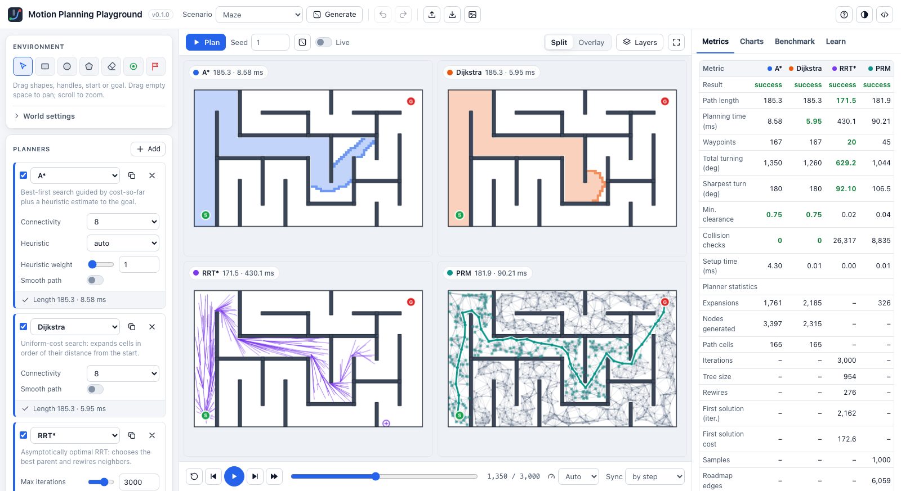
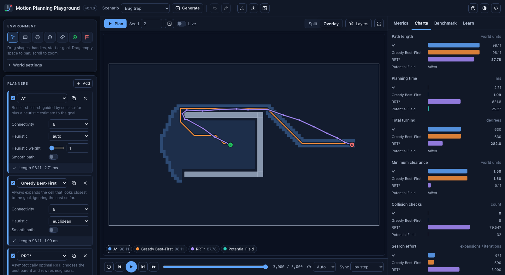
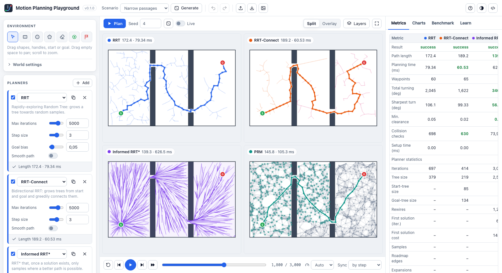

<div align="center">

# Motion Planning Playground

**Explore, visualize and compare 2D motion planning algorithms, interactively.**

[](https://github.com/evitamin01/motion-planning-playground/actions/workflows/ci.yml)

[](LICENSE)
[](https://github.com/astral-sh/ruff)



</div>

Draw a world, drop in a few planners and watch them think, step by step. Motion Planning
Playground puts graph search, sampling-based and reactive planners side by side on the
same map, records every expansion, sample and rewire, and lets you replay, compare and
benchmark them. Use it to learn how the algorithms work, to teach them, or as a small,
hackable test bed for your own planner.

## Highlights

- **Interactive world editor.** Draw rectangles, circles and polygons; drag, resize and
  rotate them; move the start and goal; undo and redo. Seven curated scenarios (bug trap,
  narrow passages, maze, office, ...) and random maze, forest and shape generators.
- **11 algorithms in three families.** BFS, Dijkstra, A\* / Weighted A\*, Greedy
  Best-First and Theta\* on grids; RRT, RRT-Connect, RRT\*, Informed RRT\* and PRM in
  continuous space; and artificial potential fields.
- **Step-by-step playback.** Every planner records a trace of its search: explored cells
  and the frontier, trees and rewiring, roadmaps, random samples, the informed-sampling
  ellipse and potential heatmaps. Play, pause, scrub and step all runs in sync.
- **Fair comparisons.** All planners share one world model with *exact* collision checking
  for a disc-shaped robot. Grids are rasterized conservatively, so every reported path is
  verified collision-free in continuous space. Seeds are explicit and planner runs are
  timed one at a time.
- **Metrics, charts and benchmarks.** Path length, planning time, smoothness, clearance and
  collision checks, plus planner-specific statistics and convergence curves for anytime
  planners. Multi-seed benchmarks across scenarios with CSV export, in the UI, the CLI or
  Python.
- **Built to learn from.** A *Learn* tab explains each algorithm with its properties and
  references; layers reveal configuration-space obstacles and the grid discretization.
- **Extensible.** A new planner is one class with a decorator. It shows up in the UI with
  an auto-generated parameter form, animation and metrics (see
  [`examples/est_planner.py`](examples/est_planner.py)).
- **Lightweight.** Pure Python + NumPy core, a small FastAPI server and a dependency-free
  browser UI (no build step, works offline).

<p align="center">
  
  
</p>

## Quick start

**With Conda** (recommended for development; everything stays inside the project folder):

```bash
git clone https://github.com/evitamin01/motion-planning-playground.git
cd motion-planning-playground
conda env create --prefix ./.conda --file environment.yml
conda activate ./.conda
mpplay serve
```

**With pip** (Python 3.10+):

```bash
pip install "motion-planning-playground[viz] @ git+https://github.com/evitamin01/motion-planning-playground.git"
mpplay serve
```

`mpplay serve` starts a local server on <http://127.0.0.1:8000/> and opens your browser.
Press **Plan** (or <kbd>Enter</kbd>) and watch the planners search. Press <kbd>?</kbd> in
the app for a guide and all keyboard shortcuts.

See [docs/development.md](docs/development.md) for the full environment setup, including
updating and removing the environment.

## Using the playground

| Area | What you can do |
| --- | --- |
| **Environment** (left) | Tools: select/move (<kbd>V</kbd>), rectangle (<kbd>R</kbd>), circle (<kbd>C</kbd>), polygon (<kbd>P</kbd>), erase (<kbd>E</kbd>), start (<kbd>S</kbd>), goal (<kbd>G</kbd>). Selected shapes have handles and numeric fields. *World settings* hold the map size, grid cell size, robot radius and start/goal coordinates. |
| **Planners** (left) | Add, duplicate, disable or remove planner runs; tune parameters (forms are generated from each planner's schema); toggle path smoothing. Duplicate a run to compare parameter settings, such as A\* with weight 1 vs. 3. |
| **Canvas** (center) | *Split* shows one panel per planner, *Overlay* shows all paths on one map. Scroll to zoom, drag empty space to pan. *Layers* toggles search progress, grid discretization, configuration space, potential heatmaps and unsmoothed paths. *Live* re-plans instantly while you edit. |
| **Playback** (bottom) | Play/pause (<kbd>Space</kbd>), step (<kbd>←</kbd>/<kbd>→</kbd>), scrub the timeline, change the speed, and sync runs *by step* (who finishes first?) or *by progress*. |
| **Results** (right) | *Metrics* table with the best values highlighted, *Charts* including convergence of RRT\*, multi-seed *Benchmark* with CSV export, and *Learn* explanations. |

Your workspace is saved in the browser. Environments can be saved and opened as JSON (the
files are compatible with the CLI), and the view can be exported as a PNG. URL parameters
such as `/?scenario=maze&planners=astar,rrt_star&mode=overlay&plan` make it easy to share
a setup or embed a demo.

## Algorithms

| Planner | Family | Complete | Optimal | Notes |
| --- | --- | --- | --- | --- |
| Breadth-First Search | Graph search (grid) | resolution | fewest moves | Baseline; ignores move costs |
| Dijkstra | Graph search (grid) | resolution | on the grid | Uniform-cost "ripple" |
| A\* / Weighted A\* | Graph search (grid) | resolution | on the grid (w = 1) | Heuristic and weight are configurable |
| Greedy Best-First | Graph search (grid) | resolution | no | Fast but easily misled (bug trap) |
| Theta\* | Graph search (grid) | resolution | near-optimal | Any-angle paths via line-of-sight (lazy variant) |
| RRT | Sampling-based | probabilistic | no | Goal-biased, rapidly exploring |
| RRT-Connect | Sampling-based | probabilistic | no | Bidirectional with greedy connect |
| RRT\* | Sampling-based | probabilistic | asymptotic | k-nearest choose-parent and rewiring; anytime |
| Informed RRT\* | Sampling-based | probabilistic | asymptotic | Samples the shrinking ellipse of improving solutions |
| PRM | Sampling-based | probabilistic | no | k-nearest roadmap, A\* query |
| Potential Field | Reactive | no | no | Gradient descent with optional random-walk escapes |

Grid planners search a conservatively rasterized occupancy grid (8- or 4-connected, no
corner cutting). The robot is a disc of configurable radius; all planners respect it.

## Command line

```bash
mpplay planners -v                         # list planners and their parameters
mpplay scenarios                           # list built-in scenarios and generators
mpplay plan -s bug_trap -p rrt_star --param max_iterations=2000 --seed 3 --plot out.png
mpplay plan -s maze -p astar -o result.json   # open result.json in the UI to replay it
mpplay benchmark -s all -p astar -p "astar:weight=3,label=WA*" -p rrt_connect -p "rrt:smooth=true" \
    -n 20 --csv trials.csv --summary-csv summary.csv
mpplay export office -o office.json        # scenario as editable JSON
mpplay generate maze --param cols=14 --param braid=0.3 --seed 7 -o maze.json
mpplay --plugin examples/est_planner.py serve  # load extra planners
```

## Python API

```python
from mpplay import RunSpec, get_scenario, run_benchmark, run_planner
from mpplay.viz import plot_result

env = get_scenario("narrow_passage")                    # or Environment.load("my_map.json")
result = run_planner(env, "rrt_connect", {"step_size": 2.0}, seed=1, smoothing=True)
print(result.success, result.metrics["path_length"], result.metrics["planning_time_ms"])
plot_result(env, result)                                # matplotlib, incl. the search tree

bench = run_benchmark([env], [RunSpec("rrt"), RunSpec("rrt_connect"), RunSpec("prm")], trials=20)
for row in bench.summary:
    print(row["run"], row["success_rate"], row["path_length_mean"])
```

[`examples/compare_planners.py`](examples/compare_planners.py) draws a figure with six
planners side by side and prints a small benchmark.

## Adding your own planner

```python
from dataclasses import dataclass
from mpplay import Planner, PlanOutcome, register_planner
from mpplay.params import ParamsBase, param

@register_planner
class StraightLine(Planner):
    name = "straight_line"
    label = "Straight line"
    summary = "Goes straight to the goal if nothing is in the way."

    @dataclass
    class Params(ParamsBase):
        samples: int = param(10, min=2, max=100, help="Points drawn along the line.")

    def plan(self, problem, rng, rec):
        if not problem.checker.segment_free(problem.start, problem.goal):
            return PlanOutcome(None, "Something is in the way.")
        rec.step()
        rec.edge("line", problem.start, problem.goal)
        return PlanOutcome([problem.start, problem.goal])
```

Save it as `my_planner.py` and run `mpplay --plugin my_planner.py serve`. Packages can also
register planners through the `mpplay.planners` entry point. The full guide, including
grid planners, traces and testing, is in [docs/adding-a-planner.md](docs/adding-a-planner.md).

## Documentation

- [Development setup](docs/development.md): Conda/pip environments, tests, linting and the release checklist
- [Architecture](docs/architecture.md): how the core, server and UI fit together
- [Adding a planner](docs/adding-a-planner.md): the plugin interface step by step
- [Trace format](docs/trace-format.md): the visualization events planners emit
- [Environment format](docs/environment-format.md): the JSON world description
- [HTTP API](docs/http-api.md): endpoints used by the UI, handy for scripting

## Project layout

```
src/mpplay/
├── geometry.py, collision.py   shapes and exact, vectorized collision checking
├── environment.py, grid.py     worlds, problems and conservative rasterization
├── planners/                   registry, base class and the built-in planners
├── runner.py, metrics.py       timing, validation, smoothing and path metrics
├── benchmark.py, scenarios.py  repeated trials, curated scenarios and generators
├── trace.py, params.py         visualization events and self-describing parameters
├── server/app.py, cli.py       FastAPI app and the `mpplay` command
└── web/                        browser UI (vanilla ES modules + Canvas, no build step)
tests/                          pytest suite (core, planners, API, CLI, examples)
examples/                       plugin planner and scripting examples
docs/                           guides and reference
```

## Roadmap

Ideas that fit the architecture well (contributions welcome):

- Non-holonomic robots (Dubins / Reeds-Shepp) and Hybrid A\*
- Dynamic replanning (D\* Lite, LPA\*) with obstacles that move during playback
- More planners: Jump Point Search, BIT\*, FMT\*, Lazy PRM, visibility graphs
- Path smoothing beyond shortcutting (B-splines, elastic bands) and trajectory timing
- A zero-install static demo that runs the Python core in the browser via Pyodide

## Contributing

Bug reports, new scenarios, planners and documentation improvements are very welcome.
Please read [CONTRIBUTING.md](CONTRIBUTING.md) and our [Code of Conduct](CODE_OF_CONDUCT.md).

## License and citation

Released under the [MIT License](LICENSE). If the playground helps your teaching or
research, a citation is appreciated; see [CITATION.cff](CITATION.cff).
